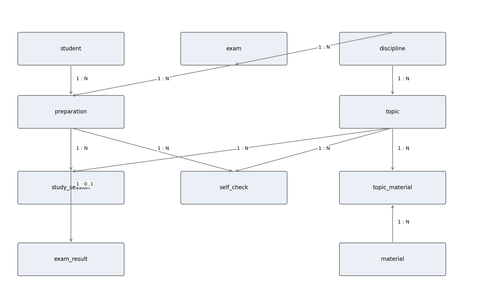
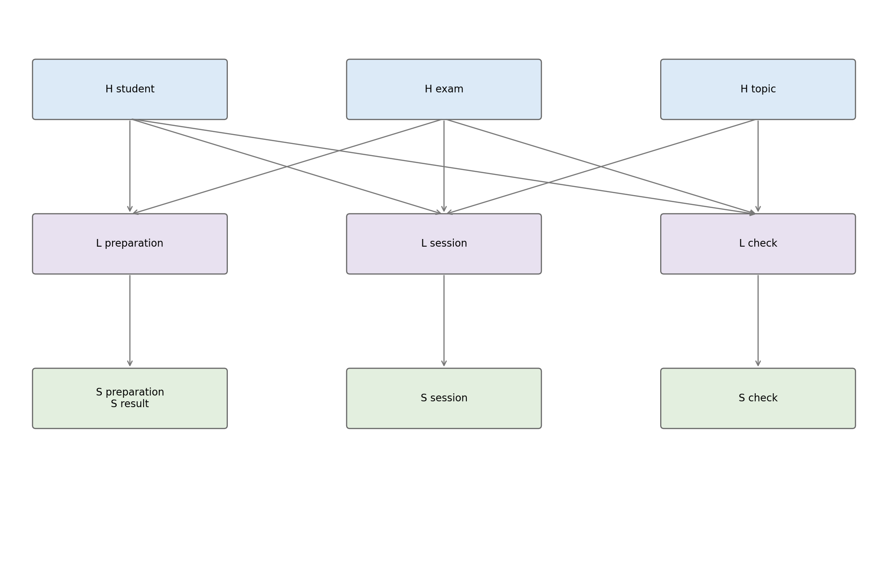

# Лабораторная работа 2 - публикация материалов на GitHub

**Автор:** Кулманаков Денис. **Вариант:** 1.

По заданию второй лабораторной создан репозиторий и размещены файлы предыдущей лабораторной работы. Предметная область - подготовка студента к экзамену с целью получить оценку «отлично».

## Материалы предыдущей работы

- [Отчёт Word](docs/Кулманаков%20Денис%20Лаб%201%20Вариант%201.docx) - описание предметной области, модели 3НФ и Data Vault, обоснование нормализации и SQL.
- [SQL для PostgreSQL](sql/lab2_variant1.sql) - создание таблиц, ограничения, триггеры, демонстрационные данные и загрузка истории.
- [Модель 3НФ](diagrams/model_1.png).
- [Основной контур Data Vault](diagrams/model_2.png).





## Запуск SQL

Требуется PostgreSQL 14 или новее и отдельная пустая учебная база данных.

Через pgAdmin: создать базу, открыть Query Tool, загрузить `sql/lab2_variant1.sql` и выполнить весь файл.

Через терминал с установленными утилитами PostgreSQL:

```bash
createdb lab2
psql -v ON_ERROR_STOP=1 -d lab2 -f sql/lab2_variant1.sql
```

При необходимости укажи параметры подключения `-h` и `-U`.

Скрипт создаёт схемы `exam_3nf` и `exam_dv` в одной транзакции. Полный повторный запуск требует новой пустой базы; скрипт не удаляет существующие объекты.

## Демонстрационный сценарий

В источнике результат самопроверки меняется с 80 на 95. Хранилище сохраняет две версии в `exam_dv.sat_check`; повторная загрузка второго снимка не должна создавать третью версию. Последние запросы SQL показывают историю, актуальный результат и сравнение целевой и фактической оценки.

Данные учебные. Полный запуск непосредственно в PostgreSQL при подготовке первой работы не выполнялся; проверялась логика переноса и повторной загрузки в совместимом тестовом окружении. Во второй лабораторной SQL перенесён без изменений.

## Ссылка для сдачи второй лабораторной

https://github.com/Coolmanakov/Data-Vault-Lab2

Название отчёта сохранено как «Лаб 1», согласно организации работ. Внутри отчёта и в комментарии SQL указан номер 2 из исходного задания по реализации Data Vault.
